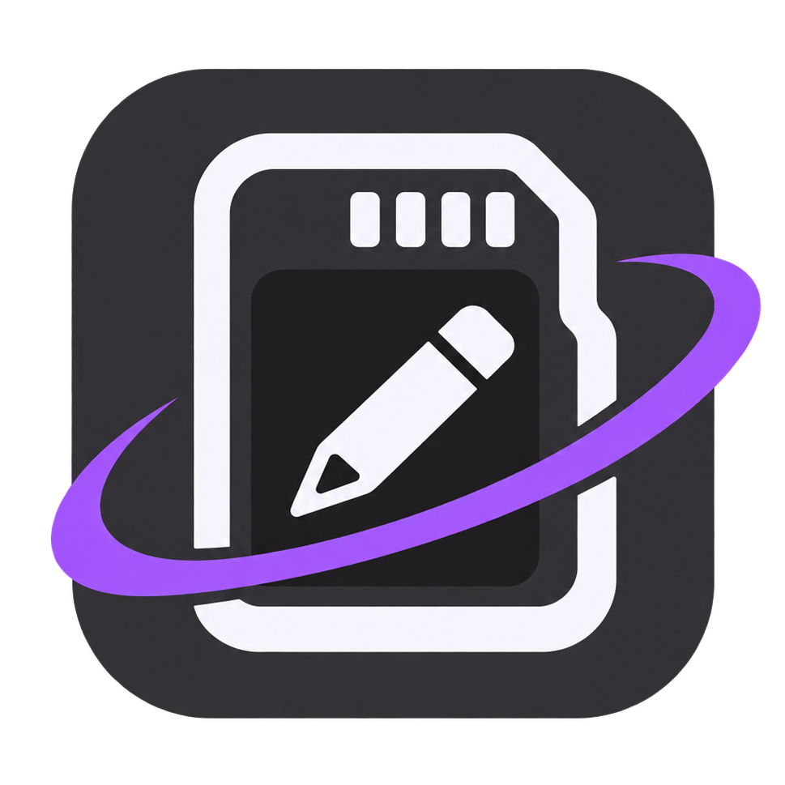
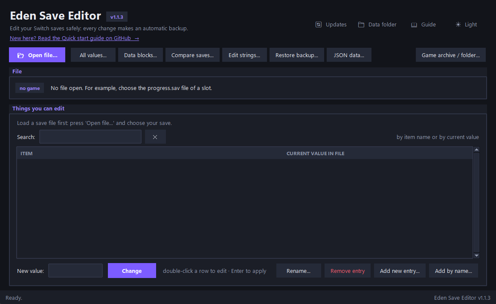

<p align="center">
  
</p>

<h1 align="center">Eden Save Editor</h1>

<p align="center">
  A simple Python/Tkinter save editor to inspect and edit <strong>your own</strong> save files<br>
  of Nintendo Switch 2 games played on <a href="https://git.eden-emu.dev/eden-emu/eden">Eden</a>-based emulators (like <a href="https://github.com/Eglantine-Community/Eglantine">Eglantine</a> or <a href="https://github.com/zortos293/Lichii">Lichii</a>).<br>
  No predefined entries needed: you find a value, give it a name, and the tool remembers it.
</p>

<p align="center">
  <a href="https://github.com/anormalhorse/eden-save-editor/releases/latest"></a>
  <a href="LICENSE"></a>

<p align="center">
  <a href="https://github.com/anormalhorse/eden-save-editor/releases/latest/download/EdenSaveEditor-windows-x64.zip"></a>&nbsp;&nbsp;
  <a href="https://github.com/anormalhorse/eden-save-editor/releases/latest/download/EdenSaveEditor-linux-x64.tar.gz"></a>&nbsp;&nbsp;
  <a href="https://github.com/anormalhorse/eden-save-editor/releases/latest/download/EdenSaveEditor-macos-arm64.zip"></a>
</p>

<p align="center">
  <a href="#quick-start">Quick start</a> ·
  <a href="#features">Features</a> ·
  <a href="#requirements">Requirements</a> ·
    <a href="#optional-ready-made-entries-saved_fieldsjson">Ready-made entries</a>
</p>
<p align="center">
  <a href="#which-tutorial-should-i-follow">Tutorials</a> ·
  <a href="#game-specific-tips">Game tips</a> ·
  <a href="#troubleshooting">Troubleshooting</a> ·
  <a href="#legal-notice">Legal</a>
</p>


---

<p align="center">
  
</p>

> [!WARNING]
> **Unofficial.** Not affiliated with Nintendo, the Eden project or any game publisher. This tool contains **no games, no firmware, no keys and no decryption**. Use it only on saves and dumps you created yourself from games you legally own.

---

## What is it?

Games keep things like coins, items and story progress in a **save file**. Eden Save Editor opens
that file, helps you **find** where a value is stored, lets you **name** it (for example "Coins")
and then **change** it. You do not need to know anything about the file format.

1. **Open** one of your saves (`Open file...`).
2. **Find** the value you want: the wizard compares two saves, or `All values` lists everything in the file.
3. **Change** it and press `Change`. A backup is made automatically, so you can always go back.

```
   📂 Open your save
          │
          ▼
   🔍 Find the value    (wizard, Compare two saves, All values...)
          │
          ▼
   ✏️ Change it
          │
          ▼
   💾 Automatic backup  ──►  ⏪ Restore a backup, if something goes wrong
```

The editor is not tied to one game: you teach it what to look for, and it remembers your fields. If you
prefer not to search yourself, an **optional** `saved_fields.json` with ready-made entries is kept in the repository
and can be added from inside the program (see [Optional: ready-made entries](#optional-ready-made-entries-saved_fieldsjson)).

> [!NOTE]
> For *Ocarina of Time Remake* (title ID `0400486024DEC000`) a small set of known names and default
> fields is built in. See also [Game-specific tips](#game-specific-tips).

---

## Quick start

1. **Close the game/emulator.**
2. **Start the program**: extract the downloaded file and run it (`EdenSaveEditor.exe` on Windows, `EdenSaveEditor` on Linux, the app on macOS), or run `python eden_save_editor.py` if you use the script.
3. Click `Open file...` and choose one of your save files
   (default folder: `%APPDATA%\eden\nand\user\save`).
4. **Pick a field** in the list (use the `Search` box above it to find an item by its name or by its current value). If the list is empty, create your own (see
   [Tutorial 1](#tutorial-1-find-a-number-example-a-coin-counter)) or use the optional ready-made entries.
5. **Type the new value** and press `Change` (or <kbd>Enter</kbd>). A backup is created automatically.

> [!NOTE]
> The builds are unsigned, so Windows SmartScreen or macOS may show a warning on first launch.
> Windows: *More info* → *Run anyway*. macOS: right-click the app → **Open**.

> [!NOTE]
> **Updates are mandatory.** When a new version is published, the program asks you to update at startup
> and does it by itself (see [Updates](#updates)). If you downloaded a version without this feature,
> download the latest release once by hand: after that, updates are automatic.

> [!TIP]
> Double-click a row to copy its current value into the box. `Rename...` changes its label, and
> `Restore a backup...` undoes any change.

| Shortcut | What it does |
|:--|:--|
| <kbd>Ctrl</kbd> + <kbd>O</kbd> | Open a file |
| <kbd>Ctrl</kbd> + <kbd>F</kbd> | Go to the search box of `Things you can edit` |
| Double-click a row | Edit that row |
| <kbd>Enter</kbd> | Apply the new value |
| <kbd>F2</kbd> | Rename the selected field |
| <kbd>Del</kbd> | Remove the selected entry |

---

## Features

### Everyday editing
- **Your own fields**: find a numeric value (whole number or decimal) in a save, give it a name
  such as "Coins", "Health" or "Counter A" and edit it whenever you like. Fields are stored per game
  and save file name in `saved_fields.json`.
- **Rename entries**: `Rename...` changes the label of a field in the main list without
  touching the save.
- **Add by name**: type an internal name (e.g. `IsGet.Item_Hookshot`) and, if the save contains it,
  it is added to the main list.
- **No duplicates**: the same key cannot be listed twice. If you add an entry whose key is already in
  the list under another name, the program asks whether to **rename the existing entry** to the new name
  (it keeps its place in the list) or **cancel**. A name already used by a different key is refused
  instead of silently overwriting that entry.
- **Extra value types**: unsigned whole number (`uint32`) and raw hex (`0x3F800000`).
- **Modern interface**: dark and light theme (top-right corner, remembered), sharp text on
  high-DPI screens, status bar, alternating rows. Every window opens large enough to show all its
  buttons, and long tables have a scrollbar. Keyboard shortcuts are listed in the [Quick start](#quick-start).
- **App icon**: the program has its own icon in the window, the taskbar and on the
  downloaded executable.

### Finding values
- **Find-a-value wizard** (`Add new entry...`): give it 2 saves where the same value differs and it finds
  the position or key ([Tutorial 1](#tutorial-1-find-a-number-example-a-coin-counter)).
- **Search your entries**: the `Things you can edit` list has a `Search` box that filters the items as you type,
  by **item name** or by **current value** (e.g. type `Rupees`, or `500`). `✕` clears it; <kbd>Ctrl</kbd> + <kbd>F</kbd> jumps to it.
- **Compare two saves**: take a save before and after one action in the game and see what changed.
  It also shows entries that exist in only one of the saves, and a `Name` column when the key is known
  ([Tutorial 2](#tutorial-2-discover-values-with-compare-two-saves)).
- **All values** (`All values (inventory, progress...)...`): lists **every** value of the save with its
  key, whole, decimal and raw hex view. Filter by name, key or number, select **many rows and change them
  at once** (e.g. every inventory quantity), export to CSV
  ([Tutorial 5](#tutorial-5-browse-and-edit-every-value-inventory-progress)).
- **Edit strings**: lists text stored in fixed-size slots (usually 32 or 64 bytes) and lets you replace
  it within the slot length (ASCII only) ([Tutorial 3](#tutorial-3-find-and-edit-strings)).
- **Data blocks**: shows the variable-size area after the hash table (lists of IDs...). Adding or removing
  entries of a size-prefixed list automatically updates the size field and every later pointer, so the
  save stays valid ([Tutorial 6](#tutorial-6-edit-lists-in-the-data-blocks)).

### Naming the keys
- **Names from the game**: load a list of names (e.g. the list saved from the NUP search). The key is a
  hash of the name, and the program detects which of 16 hash variants[^hashes] the game uses. Ranges like `PouchItem_{0-19}` are expanded.
  Names are stored in `hash_names.json`.
- **Find names for the open save**: automatic reverse lookup. The program reads every word
  stored in the game files, builds candidate names, hashes them and names the keys of your save that match
  ([Tutorial 7](#tutorial-7-find-the-names-of-unknown-keys-automatically)). It has its own tab, with a
  live log of every name matched and the file it came from. You can **limit the search by folder**:
  read only the files whose path contains some text, and/or skip others (by default textures, models, effects, terrain,
  shaders, audio and videos are skipped, because their binary data only produces false matches).
- **Game recognition by content**: a save copied outside its title folder is still
  recognised as *Ocarina of Time Remake* from its well-known keys, so its names work everywhere.

### Game files
- **NUP archive and game folder browser** for **unencrypted dumps of games you own**: browse, search
  (including zstd-compressed files) with live results, copy names, save the list, extract. It
  also opens a **game folder** (the already extracted contents of a NUP) and works on it in place
  ([Tutorial 4](#tutorial-4-browse-and-search-a-game-dump-nup)).

> [!NOTE]
> Compressed data inside a NUP needs `pip install zstandard` (not needed if you use the downloaded program).

### Updates
- **Automatic, mandatory program updates**: every time it starts, the program checks the latest
  [release](https://github.com/anormalhorse/eden-save-editor/releases/latest) on GitHub. If a newer
  version exists, a window shows the release notes and the program cannot be used until it is updated
  (`Update now`, or `Quit program`). It downloads the right file for your system (Windows `.exe`, Linux
  binary, macOS `.app`, or the `.py` script), checks it, replaces itself and restarts. The previous version is
  kept in `program_backups/` in the [data folder](#files-created-by-the-program-data-folder).
  The `🔄 Updates` button in the header checks again whenever you want.
- **If it cannot update itself** (for example the program is in a folder you cannot write to, or it is a
  `git` copy), the window offers the release page so you can download it by hand. With no internet
  connection the program simply starts.
- **New data from GitHub**: the program also compares your `hash_names.json` and `saved_fields.json`
  with the project's. If GitHub has entries you are missing, a bar appears under the header with
  `Add all new` or `Review and add...`
  ([Tutorial 8](#tutorial-8-export-import-and-merge-your-data-files)). Nothing of yours is ever removed.
- **Import from GitHub (replace)**: in `JSON data...`, the red `Import from GitHub` button downloads the project's file
  and **replaces** yours with it, without merging (a backup is made first). Use it when you want an exact copy.

### Safety
- **Automatic backups** in `save_backups/` before every modification (several backups in the same second
  never overwrite each other; batch edits make one backup).
- **Restore a backup**: put back any earlier version of the file (the current one is backed up first).

<p align="right"><a href="#eden-save-editor">⬆ Back to top</a></p>

---

## Quick glossary

| Term | Meaning |
|------|---------|
| **Save file** | The file where the game stores your progress. |
| **Field** | An entry in the editor's main list: a name you chose, where its value is in the save, and its type. |
| **Key** | The ID the game uses to find a value in the save. It is usually a *hash* of a name. |
| **Hash** | A number computed from a name. It cannot be reversed, so the editor tries many names instead ([Tutorial 7](#tutorial-7-find-the-names-of-unknown-keys-automatically)). |
| **NUP** | A game archive format (`.nup`) for unencrypted Switch dumps, created by [a55uka/nup](https://github.com/a55uka/nup). The editor can browse and search it without extracting. |
| **Backup** | A copy of the save made automatically in `save_backups/` before each change. |

---

## Requirements

Only needed if you run the script instead of the downloaded program.

- Python 3.8+ (Tkinter is included with the standard Windows installer)
- Optional: `zstandard` for compressed NUP data

```bash
pip install -r requirements.txt
python eden_save_editor.py
```

---

## Optional: ready-made entries (`saved_fields.json`)

Finding values takes a bit of work, so the project keeps a `saved_fields.json` in the repository
with entries (names + keys/offsets) that have already been found for several games.

> [!NOTE]
> It is completely optional: the editor works fine without it.

**How to use it**

1. In the editor, open `JSON data...` → `Update from GitHub...`.
2. The program downloads the project's file **without saving it**, shows the differences and adds only the entries you are missing: your own fields are never removed or overwritten
   ([Tutorial 8](#tutorial-8-export-import-and-merge-your-data-files)).
3. Open your save. Entries for your game appear in the list.

**Keeping up to date**

The program also tells you by itself when GitHub has entries you are missing (a bar under the header with
`Add all new` or `Review and add...`). If you prefer to do it by hand, `saved_fields.json` is in the
[repository](https://github.com/anormalhorse/eden-save-editor/blob/main/saved_fields.json): put it in the
**data folder** (`📁 Data folder` button) only after backing up your own `saved_fields.json`.

> [!CAUTION]
> Entries can stop working after a **game update** (keys or positions may change). If an entry
> shows a strange value, don't write to it: create your own with the tutorials below.

> [!TIP]
> Always test an entry on a copy of your save first.

<details>
<summary><strong>What it contains (and doesn't)</strong></summary>

<br>

- Only entry names, key/offset information and value types.
- No game data, no save files, no encryption keys, no copyrighted content.

</details>

<p align="right"><a href="#eden-save-editor">⬆ Back to top</a></p>

---

## Which tutorial should I follow?

| I want to... | Go to |
|:--|:--|
| Change a number (coins, health, counters) | [Tutorial 1](#tutorial-1-find-a-number-example-a-coin-counter) |
| See what changed in the save after one action in the game | [Tutorial 2](#tutorial-2-discover-values-with-compare-two-saves) |
| Change a text or a name | [Tutorial 3](#tutorial-3-find-and-edit-strings) |
| Search the game files for internal names | [Tutorial 4](#tutorial-4-browse-and-search-a-game-dump-nup) |
| See every value and edit many at once (e.g. inventory) | [Tutorial 5](#tutorial-5-browse-and-edit-every-value-inventory-progress) |
| Add or remove IDs in a list (e.g. unlocked items) | [Tutorial 6](#tutorial-6-edit-lists-in-the-data-blocks) |
| Get names for unnamed keys automatically | [Tutorial 7](#tutorial-7-find-the-names-of-unknown-keys-automatically) |
| Update, share, back up or combine my names / saved fields with GitHub or another file | [Tutorial 8](#tutorial-8-export-import-and-merge-your-data-files) |
| Undo a change | [Restoring a backup](#restoring-a-backup) |

---

## Tutorial 1: Find a number (example: a coin counter)

**Goal:** find a number (coins, health...) and name it. **You need:** two saves where only that number is different.

Before you start:

- [ ] The game/emulator is closed
- [ ] You know the exact number the game shows in each save
- [ ] Only that one thing changes between the two saves

The editor does not know where anything is stored, so you teach it by showing it
saves where **only that number is different**. Example with a generic game that has
a coin counter:

1. **Make save A.** In the game you have, say, **10 coins**. Save the game, then
   close the game/emulator. Copy the save file somewhere (e.g. `coins_10.sav`).
2. **Make save B.** Start the game again, change **only the coins** (collect or spend
   some) so you now have, say, **25 coins**. Save, close the game, copy the file
   (e.g. `coins_25.sav`).
3. In the editor, click `Open file...` and open one of the two saves.
4. Click `Add new entry...`. In the wizard:
   - type the name you want for the field in `Name of the entry:` (here `Coins`; the box starts empty)
   - click `Choose file...` for each save and type the number that save had
     (10 for the first, 25 for the second)
   - click `Find`
5. If the tool says **Found!**, click `Save entry`. The field now appears in the list
   (`Item` / `Current value in file`).
6. Select `Coins`, type a new value in `New value:` and press `Change`.
7. Start the game and check the result.

> [!TIP]
> **Tips for better results**
> - Change **only one thing** between saves. Don't play for 20 minutes in between.
> - Use numbers that are clearly different from each other and not common (e.g. 37 and
>   412 are better than 1 and 2), so fewer unrelated matches appear.
> - If nothing is found, make sure the numbers you typed are exactly what the game
>   showed. Some games display a value that differs from the stored one (decimals,
>   multiples, or "tenths"): try the `Decimal number` type, or a third save.
> - If several candidates appear, add a third save with another number to narrow it down.
> - Use `Whole number` for counters and `Decimal number` for values with decimals.

## Tutorial 2: Discover values with "Compare two saves"

**Goal:** see exactly what changed in a save after one action in the game. **You need:** a save from before and one from after.

Use this when you don't know what a value looks like, or you want to find *what changes*
after an action.

1. Save the game, close it, and copy the file (**before**).
2. Start the game, do **exactly one** thing (open a chest, use an item, finish a quest,
   pick up one object), save, close, and copy the file (**after**).
3. Click `Compare two saves...`, choose the two files with `Choose file...`, and
   press `Compare`.
4. Look at the list of changed entries. To reduce noise you can enable:
   - `Hide on/off switches (0 and 1)`
   - `Hide internal positions (jump by 64)`
5. Select the entry that makes sense (a counter that went up by 1, a value that
   changed by the amount you expect) and click `Use as entry...` to name it and add
   it as an editable field.
6. Entries marked `-` exist in only one of the two saves (e.g. an item you obtained for
   the first time). If the key is already named, its name is shown in the `Name` column.
   For unnamed keys see [Tutorial 7](#tutorial-7-find-the-names-of-unknown-keys-automatically).

> [!TIP]
> The fewer actions between the two saves, the fewer entries change, and the easier
> it is to recognize the right one.

## Tutorial 3: Find and edit strings

**Goal:** change a name or text stored in the save. **You need:** just the open save.

Many saves contain names (items, locations, internal IDs) stored as text in **fixed-size
slots**. `Edit strings...` shows them so you can replace the text.

1. Open your save with `Open file...`.
2. Click `Edit strings...`.
3. Use `Filter:` to search for part of a name. If you know a word that appears in the
   game (e.g. an item name), type it. If you don't, try a few letters, or compare with
   the NUP browser (Tutorial 4) to learn which internal names exist.
4. The list shows `Position`, `Max chars` and `Current text`. Select a row.
5. Type the replacement in `New text:` and click `Write`.

> [!IMPORTANT]
> The new text must be **ASCII-only** and **no longer than `Max chars`**. Longer text is rejected so
> the save is not corrupted. Shorter text is allowed; the rest of the slot is padded.

> [!WARNING]
> Replacing a name with one that doesn't exist in the game's data can make the game ignore it or
> misbehave. If something breaks, restore the backup from `save_backups/`.

> [!TIP]
> A good habit: change one string, load the game, confirm it works, then continue.

## Tutorial 4: Browse and search a game dump (NUP)

**Goal:** look inside a game dump to learn its internal names. **You need:** a `.nup` file or game folder that you dumped yourself.

For **unencrypted dumps of games you own**. Useful to discover internal names that
you can then look for in `Edit strings...`.

1. Click `Game archive / folder...`, then either `Open .nup...` and select the file, or
   `Open folder...` and select a game folder (the extracted contents of a NUP). A folder is
   scanned in the background (press `Stop` to cancel) and then used exactly like a NUP.
2. In the `Browse` tab, navigate folders without extracting everything. Select files
   or folders (Ctrl/Shift for several) and use `Extract selected...` if needed (from a
   folder this is a plain copy).
3. In the `Search names / text` tab, enter `Text to look for:`. Options:
   - `Ignore upper/lower case`
   - `Look inside files` (+ `Also inside compressed (.zs) files`, `Also UTF-16 text`)
   - `Only files whose path contains:` to speed up
   - The `Resource use of the searches` box at the bottom of the window (see [Limiting RAM and CPU](#limiting-ram-and-cpu-in-the-searches))
4. Press `Search`. Results appear **while** the scan continues, with a progress bar showing the
   percentage and the estimated time left; press `Stop` anytime.
5. Use `Copy selected`, `Copy names` (or right-click) and `Save list...`.
   `Extract the file of the selected row...` extracts a single file.

> [!NOTE]
> Compressed data needs `pip install zstandard` when you run the script.

## Tutorial 5: Browse and edit every value (inventory, progress)

**Goal:** see every value at once, name them and change many in one go. **You need:** just the open save.

Use this to work on many values at once without creating each field by hand.

1. Open your save and click `All values (inventory, progress...)...`.
2. Every value of the save is listed with its key, whole, decimal and raw hex view.
   Use `Filter` (name, key or number), `Only named` and `Group by name` to narrow it down.
3. **Give names to keys**, in any of these ways:
   - `Name selected...`: name one key yourself.
   - `Load names list...`: choose a text file with names from the game (for example the
     list saved from the NUP search, see Tutorial 4). The program tries all hash types,
     reports which one matches, and names every key it finds.
   - `Try a name...`: test a single name (e.g. `PlayerStatus.CurrentRupee`).
4. Select one or more rows, type the value in `New value:`, choose the type (whole,
   unsigned, decimal or raw hex) and press `Write to selected rows`. One backup is
   created for the whole operation.
5. `Add to main list` copies the selected rows to the main editable list;
   `Export CSV...` saves the table; `Reload file` re-reads the save from disk.

## Tutorial 6: Edit lists in the data blocks

**Goal:** add or remove entries in a list of IDs (for example unlocked items). **You need:** just the open save.

Some saves keep variable-length data (e.g. lists of unlocked IDs) **after** the hash
table. Pointers in the table point into this area, so resizing a list by hand would
corrupt the save.

1. Click `Data blocks...` and select a block on the left.
2. For size-prefixed lists of 64-bit values the entries are shown on the right.
3. `Remove selected` deletes entries; `New entry (hex)` + `Add entry` appends one
   (e.g. `11867CB902B55CED`). The size field and every later pointer are updated
   automatically and a backup is created.
4. `Copy selected` copies rows to the clipboard.

Only lists of 64-bit values can be edited for now. Other blocks are shown as raw data.

## Tutorial 7: Find the names of unknown keys automatically

**Goal:** automatically find the names of unnamed keys. **You need:** the open save and the game's `.nup` or folder.

A key is a hash of a name, and a hash cannot be undone. The program therefore does the
opposite: it hashes many possible names and checks which ones are keys of your save.

1. Open your save in the main window.
2. Click `Game archive / folder...`, open the `.nup` or the game folder, and go to the
   `Find names for the open save` tab. At the top it shows how many keys of the open save are still
   unnamed and which hash type is used.
3. Check the **name shapes** to try (box in the tab), separated by `;`. `{}` stands for each word found in
   the game files, so `IsGet.{}` tries `IsGet.Item_Hookshot`. The shapes are learned from the
   names already known for the game (for example `IsGet.{}` and `PouchData.{}.StockNum` for
   Ocarina of Time Remake). For a new game it starts with just `{}`: use `Add by name` on a
   few entries with their full names to teach it the shapes, or type them yourself.
   `Reset shapes` puts back the suggested ones.
   If the computer gets slow, choose `Gentle` in the `Resource use of the searches` box first (see
   [Limiting RAM and CPU](#limiting-ram-and-cpu-in-the-searches)).
   **Limit the files read** with the two boxes under the shapes:
   - `Only read files whose path contains`: pieces of a path separated by `;` (empty = every file). For example
     `/event/;/message/` reads only the files whose path has one of them.
   - `Skip files whose path contains`: pieces separated by `;`. The default is `/tex/;/model/;/effect/;.bntx;.bfres;/terrainarc/;.extm;.hght;.bake;.bfsha;.bnsh;.bfstm;.bwav;.bars;.webm;/movie/`,
     so textures, models, effects, terrain data, shaders, audio and videos (binary data that only gives random, false names) are not read.
   - Not case sensitive; each piece is matched anywhere in the path (`/tex/` is the `Tex` folder, `tex` alone would also
     match `Text`). `Text/data only` puts the default back and `Clear filters` empties both boxes. The filters used are
     written at the start of the log.
   Good folders to read are the ones with events and dialogues, item tables, actor names and game flags.
4. Press `Start` (it can take a few minutes, `Stop` cancels). A **progress bar** above the tabs
   shows the percentage, the elapsed time and an estimate of the time left (the estimate is rough
   at first and gets more accurate as the scan goes on). Under it, the tab shows the file being
   scanned and a **log**: when the search starts it lists the keys to find, the hash type and
   every name shape tried; then each name found is added as a line
   `[time] KEY  name  <- file where the word was found`, and a final line sums up the result.
   `Copy log`, `Save log...` and `Clear log` work on that text. The names found are saved in
   `hash_names.json` and appear in `All values` and `Compare saves` (run the comparison
   again to refresh the `Name` column). Keys that **already have a name** (yours, built in, or found
   earlier) are skipped: they are not searched again and never overwritten, so the result counts only new
   names. If every key of the save is already named, the search does not start.
   The names are saved **as they are found** (every few seconds), not only at the end or when
   you press `Stop`, so if the program closes or crashes you keep everything found so far.
   `hash_names.json` is written safely (temporary file, then rename), so it cannot be left
   half written. After a crash, just start the search again: names already saved are kept
   (the scan itself restarts from the beginning).

> [!NOTE]
> Keys that stay unnamed use another name shape, or are not names at all (positions,
> counters...). Use `Add by name` on a few entries to teach the program a new game's shapes.

### Limiting RAM and CPU in the searches

The `Resource use of the searches` box is at the bottom of the `Game archive / folder` window and
applies to both `Search names / text` and `Find names for the open save`. **No file is skipped by
default**: big files (and compressed `.zs` files, which are unpacked while they are read) are read
**piece by piece**, so a full analysis of every variable of a game is possible with little RAM.

| Mode | Piece size | Words remembered (name search) | CPU |
|:--|:--|:--|:--|
| `Gentle (low RAM and CPU)` | 16 MB | 500,000 | long pauses: the PC stays free, the search is slower |
| `Balanced (default)` | 64 MB | 4,000,000 | short pauses |
| `Fast (more RAM and CPU)` | 256 MB | 16,000,000 | almost no pauses |

- `Read files in pieces of (MB)` is filled by the mode but you can type any number. It is the RAM used
  for one file at a time; a name that falls between two pieces is still found (and counted once).
- `Skip files bigger than that (faster, may miss data)` is **off** by default. Turn it on only for a
  quick look: files above the piece size are then ignored.
- `Words remembered` is what uses most RAM in the name search. With fewer words a very large game may be
  scanned only in part: for a complete analysis use `Balanced` or `Fast`.
- The mode used is written at the start of the log of `Find names for the open save`.

### Notification when a long task ends

Searches, name searches, folder scans and extractions can take minutes. When one that lasted **5 seconds or
more** ends by itself (not when you press `Stop`), the program tells you even if you are in another window:

- a short **sound**;
- the **taskbar button flashes** (Windows) until you come back;
- a small **card** appears in the bottom-right corner of the screen for a few seconds with the result
  (for example `42 names found in 1,380 files`). Click it to bring the window back.

Untick `Notify me when a long task ends` (bottom right of the `Resource use of the searches` box) to turn it off.

## Tutorial 8: Export, import and merge your data files

**Goal:** share your discovered names and saved fields, move them to another PC, update them from GitHub, or combine them with someone else's file without losing anything of yours. **You need:** a `.json` file exported by another copy of the editor (or your own, for a backup), or just an internet connection for the GitHub update.

Click `JSON data...` in the main window. There is one block per file:

- **Hash names** (`hash_names.json`): the names found for the keys of each game.
- **Saved fields** (`saved_fields.json`): the entries of the main list for each save file.

For each one:

1. `Export...` saves a copy of your current data wherever you choose.
2. `Merge...` (the safe one): choose another file and the editor shows the **differences**:
   - **New**: in the file but missing in yours. Ticked by default, they will be added.
   - **Different**: the same place has another value in the file. Not ticked by default, so yours is kept unless you tick it.
   - Nothing of yours is ever removed. Click a row (or press `Space`) to tick/untick it, then press `Merge ticked`.
3. `Import (replace)...` replaces your data with the file. Use it only if you really want an exact copy: anything that is only in yours is lost.
4. `Import from GitHub` (red button, next to `Update from GitHub...`) downloads the project's file and **replaces**
   yours with it, with no merge and no comparison. It asks for confirmation first, and a backup is made in
   `save_backups`. `Import both from GitHub` does it for the two files. Anything that is only in yours is lost: use
   `Export...` first if you want to keep it.
5. `Update from GitHub...` downloads the project's current file (`hash_names.json` or `saved_fields.json` from the `main` branch of the repository) **without saving it**, then asks what to do:
   - `See the differences and add what is missing` (recommended): opens the same comparison as `Merge...`.
   - `Replace mine with the GitHub version`: asks for confirmation first, because anything only in yours is lost.
   - `Cancel`: nothing changes.

   `Update both from GitHub...` does the same for the two files, one after the other. If you are already up to date, the program says so. An internet connection is needed only for these buttons and for the check at startup.

**Notification at startup.** You do not have to remember to press the button: every time the program
starts it compares your two files with the project's. If GitHub has entries that you are missing, a bar appears under the
header ("GitHub has data that you are missing: ...") with three buttons:

- `Add all new`: adds only the missing entries, right away. Entries that exist in both with a different value are **not** touched.
- `Review and add...`: opens the same comparison as `Merge...`, so you choose row by row.
- `Dismiss`: hides the bar. It does not come back until GitHub has something new that you have not seen yet.

A backup of your file is made first in every case. The `🔄 Updates` button shows the bar again even if you dismissed it.

> [!TIP]
> Merge and Import make a backup of the previous file in the `save_backups` folder first, so you can always go back.

> [!NOTE]
> Only the content of the JSON file is exported. The names that are built into the program (for example the ones for Ocarina of Time Remake) are not part of it.

## Game-specific tips

Small tricks that are known to work in specific games. They all use the tools described in the tutorials above.

### Ocarina of Time Remake: switch between child and adult

> [!WARNING]
> Back up your `progress.sav` first (the program also does it automatically).

1. Open your `progress.sav` file
2. Click `Edit strings`
3. Search for `Market_Child` and select it
4. In the `New text` box, type `Market_Adult`
5. Click `Write` and confirm with **Yes**

To go back to child, do the reverse: search `Market_Adult` and replace it with `Market_Child`.

## Restoring a backup

Click `Restore a backup...` to see all backups of the open file (newest first) and put
one back.

> [!TIP]
> The current version is backed up first, so you can undo a restore too.

## How it works

<details>
<summary><strong>Technical details (optional reading)</strong></summary>

<br>

The save contains a hash table of `(key, value)` pairs starting at offset `0x28`.
Looking values up by key keeps edits stable even if the file layout shifts. When no
key is available, a plain offset is used. The wizard and the compare tool find these
keys/offsets by looking at what differs between your saves.

Many games compute the key as a hash of an internal name. A hash cannot be reversed, but if
you have a list of names (or let the editor collect them from the game files) it can
compute name → hash → key and label the entries for you.
Data after the table (offset in header field at `0x08`) is treated as variable-size
blocks; when one changes size, every pointer that follows is shifted by the same amount.

</details>

## Files created by the program (data folder)

These files are kept **apart from the program**, in `%APPDATA%\EdenSaveEditor` on Windows
(`AppData\Roaming`; with Python from the Microsoft Store, `C:\Users\<you>\EdenSaveEditor`, because the Store version hides AppData writes in a private folder; `~/.config/EdenSaveEditor` on Linux), so they survive updates and moving or
deleting the program folder. The `📁 Data folder` button in the header opens it. Files that an older
version kept next to the program are **copied** there the first time you start the new one (the
originals stay where they were; you can delete them once you see everything in the new folder).

| Path | Purpose |
|------|---------|
| `save_backups/` | Automatic backup before each write |
| `saved_fields.json` | Your fields, per game + file name (or the optional file from the repository) |
| `hash_names.json` | Names you gave to keys / loaded from a names list / found automatically, per game |
| `ui_settings.json` | Interface settings (dark or light theme) and which GitHub data notices you already dismissed |
| `program_backups/` | The previous version of the program, kept after each automatic update |

## Publishing a release (maintainers)

The automatic update reads the **latest published release** (drafts and pre-releases are ignored):

1. Set `APP_VERSION` in `eden_save_editor.py` (for example `"1.2.0"`) and publish the release with the **same tag**
   (`v1.2.0`). If the file inside the release says an older version than the tag, the program refuses to install it
   (it would offer the same update again and again).
2. Attach the files with these names (the program picks the right one for each system and CPU):
   - `EdenSaveEditor-windows-x64.zip`: must contain **one** `EdenSaveEditor.exe` and no folder of libraries (a multi-file build is not updated automatically)
   - `EdenSaveEditor-linux-x64.tar.gz`: the single `EdenSaveEditor` binary
   - `EdenSaveEditor-macos-arm64.zip`: the `EdenSaveEditor.app`
   - `eden_save_editor.py` (optional, for people who run the script; without it, GitHub's source zip is used)
3. The release description is shown to the users as the "what's new" text.

## Troubleshooting

> [!TIP]
> Most problems after an edit are solved by `Restore a backup...` (or by copying the latest file from `save_backups/`).

| Problem | What to try |
|---------|-------------|
| "Nothing found" in the wizard | Check the typed numbers, use more different values, try `Decimal number`, add a third save |
| A ready-made entry shows a strange value | The game may have been updated: don't write to it, create your own entry or update the entries with `JSON data...` → `Update from GitHub...` |
| Value changed but the game shows the old one | The game may use a different slot/save; make sure you opened the file the game actually loads |
| Game won't load after editing | Use `Restore a backup...` (or copy the latest file from `save_backups/`) |
| `Load names list...` says no name matches | The list may belong to another game/version, or the game uses a hash not covered; try `Try a name...` with a name you know exists |
| "Number out of range" | Pick the right type: whole numbers are -2147483648..2147483647, unsigned 0..4294967295 |
| NUP search skips compressed files | `pip install zstandard` |
| The update window says the program cannot update itself | The program is in a folder you cannot write to, or it is a `git` copy: use `Release page` and download it by hand (or `git pull`) |
| A bad update | Copy the file from `program_backups/` (in the data folder) back over the program |
| "Already in the list" when adding an entry | That key already has an entry under another name: rename the existing one, or cancel |
| `Find names for the open save` fills `hash_names.json` with random names (like `BottleA.wwgD`) | The search is reading binary files (textures...). Keep the default `Skip files whose path contains` filter, or use `Only read files whose path contains` with the folders of events and text data, and delete the false names |
| `Find names for the open save` says all keys already have a name | Nothing to search: only keys without a name are looked for |
| `Find names for the open save` only offers `{}` or finds nothing | Add a few entries with `Add by name` (full names) so the program learns the name shapes, or type the shapes by hand in the `Find names for the open save` tab; make sure the save is open in the main window |
| A search makes the PC slow or uses too much RAM | In `Resource use of the searches` choose `Gentle` and/or lower `Read files in pieces of (MB)`, then search again (no file is skipped) |
| The `Find names for the open save` tab says no save is open | Open a save in the main window, then click the tab again (it refreshes by itself) |

## Legal notice

> [!WARNING]
> This is an **unofficial** tool. It is not affiliated with, endorsed by or sponsored by Nintendo,
> the Eden project or any game publisher. "Nintendo" and "Nintendo Switch 2" are trademarks of Nintendo and are
> used here only to describe which games and platform the tool works with. All product names and trademarks belong to their respective owners.

> [!CAUTION]
> Editing saves can corrupt them. Provided "as is", without warranty: use it at your own risk and keep
> your own backups.

- The tool and the optional `saved_fields.json` contain **no game data, no encryption
  keys, no firmware and no copyrighted content**, and nothing here bypasses any
  protection or encryption. The optional file and the built-in names only list entry
  names and positions.
- Use it only with save files and game dumps that **you created yourself from games
  you legally own**. Do not share saves or dumps containing copyrighted material.
- Do not use it to cheat in online or multiplayer services, or in ways that violate
  a game's or service's terms.

## Credits

The `.nup` file format (a container for unencrypted Nintendo Switch 1/2 game dumps) was created by
[a55uka/nup](https://github.com/a55uka/nup) (MIT), which publishes its specification and a reference tool.
The NUP reader in this editor is an independent implementation written from that specification; no code was copied.

## License

MIT, see [LICENSE](LICENSE).

[^hashes]: CRC32, CRC32C, FNV-1, FNV-1a, Murmur3, DJB2, SDBM and Jenkins, each also on the lowercase name.
